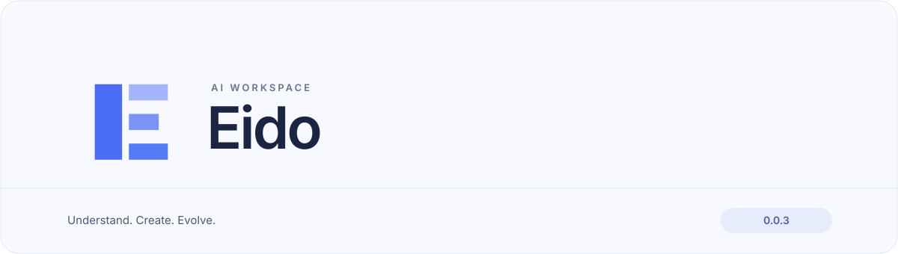

  

<h1 align="center">A workspace for getting things done with AI.</h1>

  Ask questions, work with documents, build software, and use apps. 
  Keep the task, conversation, and results together.

  <strong>English</strong> · <a href="README.zh-CN.md">简体中文</a>

  <a href="https://cairno.cn/eido/">Website</a> ·
  <a href="#whats-new-in-002">What's new</a> ·
  <a href="#download-and-install">Download</a> ·
  <a href="#get-started">Get started</a> ·
  <a href="#current-scope">Current scope</a> ·
  <a href="#acknowledgments-and-licensing">Open source</a>

---

Eido is a native AI workspace built on [Zed](https://github.com/zed-industries/zed) and the official, unmodified [pi](https://github.com/earendil-works/pi) agent. Start with an outcome, bring in relevant context, and work through the result. The conversation is central; native files, code editing, and review are available when the task needs them.

**Eido 0.0.2 is available for Apple Silicon Macs running macOS 13 or later.** It bundles **pi 1.5.2**.

  <a href="https://github.com/tony3liu/eido/releases/download/v0.0.2/Eido-0.0.2-macos-arm64.dmg"><strong>Download for Mac · Apple Silicon</strong></a> ·
  <a href="https://github.com/tony3liu/eido/releases/tag/v0.0.2">Release notes and checksums</a>

## What's new in 0.0.2

- **A clearer Workbench.** A centered new-task composer, task navigation, on-demand file views, and model and Agent Access controls together. Switching views preserves the conversation and draft.
- **English and Simplified Chinese.** Choose Follow System, English, or 简体中文 at the top of Settings. Common Eido controls and menus are localized; user content, code, model output, and tool identifiers remain unchanged.
- **More comfortable reading.** Interface and conversation text default to 16px. Ordinary completed tasks no longer leave a detached “Run finished” label; important status messages stay aligned with the input area. Existing custom font preferences are preserved.
- **Window dragging restored.** Drag the empty area in the top toolbar to move a non-fullscreen window on macOS.
- **pi 1.5.2 integration.** Updated runtime adaptation while retaining pi's public configuration and authentication interfaces.
- **Research & Documents preview.** Search and fetch sources, inspect saved evidence, extract PDF/image text, and connect requirements with proposed changes and checks. These features are experimental, disabled by default, and require separate DeepSeek service configuration.

## Work in one place

| View | Use it for |
| :--- | :--- |
| **Task** | Discussing a goal, following progress, and coordinating the work. |
| **Files** | Reading, navigating, editing, and reviewing project files. |
| **Split** | Keeping the conversation and files visible together. |

Reference relevant files with `@`, attach supporting material, and continue earlier tasks with their saved context. Review proposed file changes in the native editor before accepting them. Supported accepted file operations can be restored after checks that protect subsequent edits.

Browser Use and Computer Use extend tasks to websites and desktop applications. Eido includes Chromium and its desktop driver. An existing [Poki](https://github.com/JosssphZhou/poki) MCP installation can also connect supported iPhone workflows; Poki and device preparation are separate setup steps. Automation compatibility varies by website, application, and device.

[Watch the earlier Eido launch film](https://cairno.cn/eido/film/) · 56 seconds, in Chinese.

## Download and install

1. Download [Eido-0.0.2-macos-arm64.dmg](https://github.com/tony3liu/eido/releases/download/v0.0.2/Eido-0.0.2-macos-arm64.dmg).
2. Quit an older Eido instance, open the disk image, and drag **Eido** into **Applications**.
3. Launch Eido and configure your model and authentication in global settings.

Configuration and task history are stored outside the application bundle and preserved during local updates. Release assets include SHA-256 checksums, Eido source, and corresponding source for the native components.

This release is locally signed and **has not been notarized by Apple**. If macOS blocks the first launch, verify the download source and follow Apple's [instructions for opening an app from an unidentified developer](https://support.apple.com/guide/mac-help/open-a-mac-app-from-an-unknown-developer-mh40616/mac).

### Enable Computer Use on Mac

Enable **Computer Use** in global settings. Leave the driver path empty to use the bundled driver.

In **System Settings → Privacy & Security**, allow **Eido** under **Accessibility** and **Screen & System Audio Recording** (called **Screen Recording** on some macOS versions), then restart Eido. These permissions allow input and window capture. Replacing a locally signed build can require re-enabling them. Permission previously granted to a standalone Cua Driver does not apply to Eido.

## Get started

1. **Choose your language.** Open Settings and use the language selector at the top. The choice applies across tasks.
2. **Configure your model.** Open **AI → pi Models & Credentials** in global settings. Model and thinking controls are beside the composer.
3. **Set Agent Access.** Start with **Ask Before Actions**, or choose **Full Access** to let pi decide how to use enabled tools without individual approval prompts. This setting is global.
4. **Describe an outcome.** For example: “Explain this project and propose a small fix,” or “Use these sources to compare the options and show the evidence.”
5. **Review the result.** Read source references, inspect proposed changes, and decide what to keep.

### Research and document extraction

To try the experimental service, find **Research & Documents** in global AI configuration, enable it, set the service base URL (default `https://api.deepseek.com/v1`), and save your DeepSeek credential. Use **Sources** or the attachment menu in the composer to work with supporting material.

Search queries, requested URLs, and selected document/image content are sent to the configured service when these tools run. Service access and charges are separate from your main model configuration. Limits and usage records are available; estimated or unknown billing is not a confirmed charge. The real-service and full GUI acceptance pass for this preview is incomplete.

## Current scope

Eido keeps native editing and review while expanding beyond coding. This is still an early release:

- Localization covers the main Eido workflow. Some advanced editor settings, deeper dialogs, and third-party content remain in their original language.
- Browser Use, Computer Use, Poki integration, and Research/OCR are experimental. Background desktop input and focus isolation are not reliable across all applications.
- Plugin compatibility, language tooling, large-project performance, and more recovery scenarios continue to improve.
- The native editor is packaged from the dev profile with debug symbols disabled; this is not an optimized Cargo release build.

## Feedback

[Open an issue](https://github.com/tony3liu/eido/issues) with your goal, expected and actual behavior, a small reproduction, and **Eido 0.0.2** plus your macOS version. Remove credentials and private project content from screenshots and logs.

## Acknowledgments and licensing

Eido builds on the work of **[Zed](https://github.com/zed-industries/zed)** and **[pi](https://github.com/earendil-works/pi)**. Zed provides the native editor foundation; pi powers the coding agent. We thank their authors, contributors, and communities for making these projects available as open source.

We also thank **[browser-use/jev-ultrafast](https://github.com/browser-use/jev-ultrafast)** and its authors and contributors for sharing their browser-agent approach. Eido draws on its ideas, reimplements the agent logic in TypeScript, and adapts it to Eido's existing pi/ACP browser workflow. Adapted upstream code retains its MIT license and attribution.

Eido respects and preserves the licenses and attribution of these projects. **Eido-original code is licensed under GPL-3.0-or-later**, the same license as Zed's editor code.

| Code | License |
| :--- | :--- |
| Eido-original code and Zed editor code | [GPL-3.0-or-later](LICENSE) |
| Zed components marked Apache-2.0, including GPUI | [Apache-2.0](native/LICENSE-APACHE) |
| pi | [MIT](https://github.com/earendil-works/pi/blob/main/LICENSE) |
| Cua Driver desktop runtime | [MIT](native/cua/LICENSE-MIT) |
| jev-ultrafast browser agent and tools | [MIT](packages/runtime/src/browser/ultrafast/LICENSE) |

If you fork, modify, or distribute Eido, you must comply with the licenses that apply to each included component. Preserve license texts, copyright and attribution notices, and required modification notices. When distributing GPL-covered binaries, provide the Corresponding Source through a method permitted by the GPL and retain its licensing terms. Other dependencies retain their own licenses; see [NOTICE](NOTICE) for attribution and scope. This summary does not replace the license texts.

---

  <strong>Understand. Create. Evolve.</strong> 
  Eido · 0.0.2 · macOS

