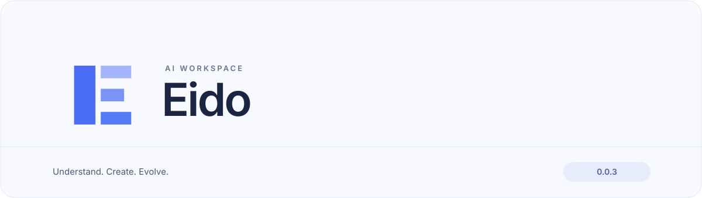

  

<h1 align="center">和 AI 一起，把事情做完。</h1>

  提出问题、处理资料、开发软件、操作应用。 
  让任务、对话和结果留在同一个工作空间。

  <a href="README.md">English</a> · <strong>简体中文</strong>

  <a href="https://cairno.cn/eido/">官网</a> ·
  <a href="#002-更新">新版变化</a> ·
  <a href="#下载与安装">下载</a> ·
  <a href="#开始使用">开始使用</a> ·
  <a href="#当前范围">当前范围</a> ·
  <a href="#致谢与开源协议">开源致谢</a>

---

Eido 是基于 [Zed](https://github.com/zed-industries/zed) 和官方未修改的 [pi](https://github.com/earendil-works/pi) 构建的原生 AI 工作空间。从一个希望完成的目标开始，带入相关资料，与 AI 一起推进结果。对话是工作入口，需要时可以随时使用原生文件浏览、代码编辑与改动审阅。

**Eido 0.0.2 现已面向 macOS 13 及以上的 Apple Silicon Mac 发布。** 内置 **pi 1.5.2**。

  <a href="https://github.com/tony3liu/eido/releases/download/v0.0.2/Eido-0.0.2-macos-arm64.dmg"><strong>下载 Mac 版 · Apple Silicon</strong></a> ·
  <a href="https://github.com/tony3liu/eido/releases/tag/v0.0.2">版本说明与校验文件</a>

## 0.0.2 更新

- **更清晰的 Workbench。** 新任务输入区居中，提供任务导航和按需展开的文件视图；模型与 Agent Access 放在一起。切换视图时保留对话和草稿。
- **中英文界面。** 在设置顶部选择“跟随系统”、English 或简体中文。常用 Eido 控件和菜单已接入 i18n，用户内容、代码、模型回复和工具标识保持原文。
- **更舒适的阅读。** 界面与对话正文默认 16px；普通完成的任务不再显示孤立的“运行已结束”，重要状态提示与输入区对齐。已有自定义字号偏好会保留。
- **恢复窗口拖动。** macOS 非全屏时，可以按住顶部工具栏的空白处拖动窗口。
- **适配 pi 1.5.2。** 更新内置运行时，继续使用 pi 的公开配置与认证接口。
- **Research & Documents 预览。** 搜索和抓取来源、查看保存的原文依据、提取 PDF/图片文字，将需求关联到提议的改动与检查。该功能处于实验阶段，默认关闭，需要单独配置 DeepSeek 服务。

## 在同一个空间工作

| 视图 | 适合的工作 |
| :--- | :--- |
| **任务** | 讨论目标、查看进展、协调工作。 |
| **文件** | 阅读、导航、编辑与审阅项目文件。 |
| **分栏** | 同时查看对话与文件。 |

通过 `@` 引用相关文件，添加辅助资料，带着保存的上下文继续之前的任务。在原生编辑器里理解提议的改动，再决定是否接受。已接受且支持恢复的文件操作，可以在保护后续编辑的检查通过后恢复。

Browser Use 和 Computer Use 将任务延伸到网页与桌面应用，应用内置 Chromium 和桌面驱动。也可以连接已配置好的 [Poki](https://github.com/JosssphZhou/poki) MCP，使用其支持的 iPhone 工作流；Poki 安装和真机准备需要单独完成。自动化兼容性会因网站、应用和设备而异。

[观看早期 Eido 发布影片](https://cairno.cn/eido/film/) · 56 秒，中文。

## 下载与安装

1. 下载 [Eido-0.0.2-macos-arm64.dmg](https://github.com/tony3liu/eido/releases/download/v0.0.2/Eido-0.0.2-macos-arm64.dmg)。
2. 退出旧版 Eido，打开磁盘映像，将 **Eido** 拖入 **Applications**。
3. 启动 Eido，在全局设置中配置模型和认证信息。

配置与任务历史保存在应用包之外，本地更新时会保留。Release 同时提供 SHA-256 校验文件、Eido 源码和原生组件的对应源码。

本版已做本地签名，**尚未通过 Apple 公证**。如果 macOS 阻止首次启动，请确认下载来源后，按照 Apple 的[打开未知开发者应用说明](https://support.apple.com/zh-cn/guide/mac-help/mh40616/mac)操作。

### 在 Mac 上开启 Computer Use

在全局设置中启用 **Computer Use**，驱动路径留空即可使用内置驱动。

到 **系统设置 → 隐私与安全性**，分别在 **辅助功能** 和 **屏幕与系统音频录制**（部分 macOS 版本名为 **屏幕录制**）中允许 **Eido**，然后重启应用。这两项权限用于输入操作与窗口采集。更换本地签名版本后，系统可能要求重新启用权限；以前授予独立 Cua Driver 的权限不会自动转移给 Eido。

## 开始使用

1. **选择界面语言。** 打开设置，在顶部选择语言，对所有任务全局生效。
2. **配置模型。** 在全局设置的 **AI → pi Models & Credentials** 中配置认证；输入框旁可以选择模型和思考级别。
3. **选择 Agent Access。** 可以从“操作前询问”开始；选择“完全访问”后，pi 会自行决定如何使用已启用工具，不再逐项请求批准。授权模式全局生效。
4. **描述希望得到的结果。** 例如：“解释这个项目，提出一个尽量小的修复”，或“根据这些资料比较几个方案，并给出原文依据”。
5. **审阅结果。** 查看来源引用、检查提议的改动，再决定保留哪些内容。

### 技术研究与文档提取

如需试用实验服务，在全局 AI 配置中找到 **Research & Documents**，开启功能，设置服务地址（默认 `https://api.deepseek.com/v1`），并保存 DeepSeek 凭据。通过输入区的“资料”或附件菜单处理相关材料。

运行这些工具时，搜索词、请求的 URL，以及所选文档或图片内容会发送给配置的服务。服务权限与费用独立于主模型配置。可设置使用限制并查看用量记录；估算或未知计费不代表已确认扣费。此预览的真实服务与完整界面验收尚未完成。

## 当前范围

Eido 保留原生编辑与审阅能力，同时扩展到编程之外的任务。当前仍是早期版本：

- 汉化覆盖 Eido 主工作流程，部分高级编辑器设置、深层弹窗和第三方内容仍保持原语言。
- Browser Use、Computer Use、Poki 接入以及 Research/OCR 均为实验功能；桌面后台输入与焦点隔离尚不能保证适用于所有应用。
- 插件兼容性、语言工具、大项目性能和更多恢复场景仍在完善。
- 原生编辑器采用关闭调试符号的 dev profile 打包，并非优化后的 Cargo release 构建。

## 反馈建议

欢迎[提交 Issue](https://github.com/tony3liu/eido/issues)，说明目标、预期与实际表现、简短复现步骤，以及 **Eido 0.0.2** 和 macOS 版本。分享截图或日志前，请移除凭据和不适合公开的项目内容。

## 致谢与开源协议

Eido 建立在 **[Zed](https://github.com/zed-industries/zed)** 与 **[pi](https://github.com/earendil-works/pi)** 的开源成果之上。Zed 提供原生编辑器基础，pi 提供编程 Agent 能力。感谢两个项目的作者、贡献者与社区，让这些优秀的工具以开源方式惠及更多开发者。

同时感谢 **[browser-use/jev-ultrafast](https://github.com/browser-use/jev-ultrafast)** 的作者与贡献者开源其浏览器 Agent 方案。Eido 借鉴该项目的思路，使用 TypeScript 重新实现相关 Agent 逻辑，并适配到 Eido 现有的 pi/ACP 浏览器链路。借用和适配的上游代码保留其 MIT 许可证与署名。

Eido 尊重并保留这些项目的许可证与署名。**Eido 自有代码采用 GPL-3.0-or-later**，与 Zed 编辑器代码的许可证一致。

| 代码范围 | 开源协议 |
| :--- | :--- |
| Eido 自有代码与 Zed 编辑器代码 | [GPL-3.0-or-later](LICENSE) |
| Zed 中标明 Apache-2.0 的组件，包括 GPUI | [Apache-2.0](native/LICENSE-APACHE) |
| pi | [MIT](https://github.com/earendil-works/pi/blob/main/LICENSE) |
| Cua Driver 桌面运行时 | [MIT](native/cua/LICENSE-MIT) |
| jev-ultrafast 浏览器 Agent 与工具 | [MIT](packages/runtime/src/browser/ultrafast/LICENSE) |

如果你 fork、修改或分发 Eido，需要遵守所包含各组件的许可证：保留许可证全文、版权与署名，以及要求的修改声明。分发受 GPL 约束的二进制程序时，须通过 GPL 允许的方式提供对应源码，并保留其授权条款。其他依赖仍适用各自的许可证；具体归属与范围见 [NOTICE](NOTICE)。本说明不替代许可证全文。

---

  <strong>理解。创造。演进。</strong> 
  Eido · 0.0.2 · macOS

